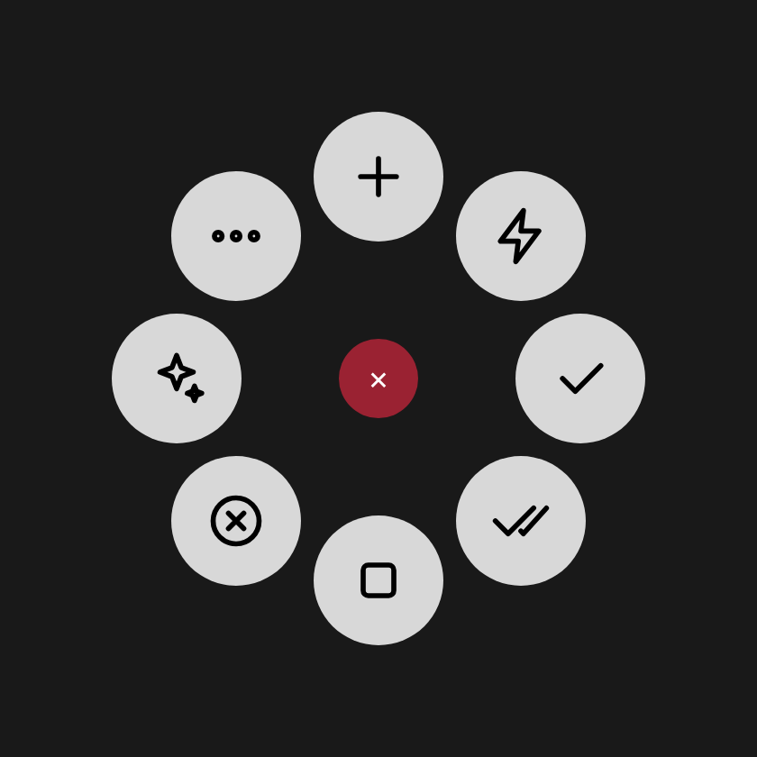

# Claude Code × MX Master 4

[English](README.md) · **Español**

Controla **Claude Code Desktop** (la pestaña *Code* de la app de escritorio de Claude) desde el **Logitech MX Master 4**.
Aprueba, rechaza o detén las solicitudes de permiso de Claude **directamente desde el mouse** a través de los hooks
oficiales de Claude Code (no atajos de teclado), y **siente** cuando Claude te necesita o termina. Las mismas acciones
están disponibles como **servidor MCP**.



## Cómo se comunica con Claude

| Mecanismo | Para qué se usa | Funciona cuando… |
|---|---|---|
| **Hooks de Claude Code** (oficiales, [docs](https://code.claude.com/docs/en/hooks)) → servidor local del plugin | Aprobar · Aprobar todo · Rechazar · Detener una solicitud de permiso, y vibraciones en eventos reales | Siempre: cualquier ventana, cualquier foco. Claude Desktop ejecuta los hooks de `~/.claude/settings.json` |
| **Enlace `claude://code/new`** (oficial, [docs](https://code.claude.com/docs/en/desktop)) | Nueva sesión | Siempre |
| Atajos de teclado (los documentados) | Solo lo que no tiene interfaz oficial: enviar ahora, menús de modelo y de modo de permisos, paneles, comandos `/` | Claude Desktop está al frente |

```
 Claude Code (Desktop) ──hooks HTTP──▶ plugin de Logi (127.0.0.1:47823) ──▶ el MX Master 4 vibra
        ▲                                    │
        └──── decisión (permitir/negar) ◀── pulsas Aprobar / Rechazar / Detener en el Actions Ring
```

Cuando Claude pide permiso, el mouse "toca la puerta", la burbuja muestra la herramienta (`Aprobar · Bash`) y la
solicitud espera hasta 20 s tu respuesta. Si no respondes desde el mouse, Claude Desktop muestra su diálogo de
siempre. Si Logi Options+ no está abierto, Claude Code funciona normal (un hook que no conecta no bloquea nada).

## Acciones

| Grupo | Acción | Cómo |
|---|---|---|
| Permisos | **Aprobar** | Hook: permite la solicitud pendiente (solo esa) |
| | **Aprobar todo** | Hook: la permite **y** pasa la sesión a *Accept edits*. Sin nada pendiente: menú de permisos → *Accept edits* |
| | **Rechazar** | Hook: la niega; Claude sigue con otra estrategia |
| | Modo Auto / Plan / Manual · Menú de permisos | Menú de permisos (`Cmd/Ctrl+Shift+M`) |
| Prompt | **Detener** | Hook: niega la solicitud pendiente e interrumpe a Claude. Sin nada pendiente: `Esc` |
| | **Enviar ahora** | `Esc` + `Enter` (interrumpe y envía lo que escribiste) |
| | Enviar · Aceptar sugerencia | `Enter` · `Tab` |
| Sesiones | **Nueva sesión** | `claude://code/new` (respaldo `Cmd/Ctrl+N`) |
| | Cerrar · Siguiente · Anterior | `Cmd/Ctrl+W` · `Cmd/Ctrl+Shift+]` · `Cmd/Ctrl+Shift+[` |
| Modelo | Cambiar modelo · Modelo: Opus / Sonnet / Haiku · Esfuerzo | Menú de modelos (`Cmd/Ctrl+Shift+I`) → 1/2/3 · `Cmd/Ctrl+Shift+E` |
| Vista | Diff · Terminal · Navegador · Chat lateral · Cambiar vista · Cerrar panel · Atajos | `Cmd/Ctrl+Shift+D` · ``Ctrl+` `` · `Cmd/Ctrl+Shift+B` · `Cmd/Ctrl+;` · `Ctrl+O` · `Cmd/Ctrl+\` · `Cmd/Ctrl+/` |
| Comandos | `/compact` · `/context` · `/code-review` | Escribe el comando y lo envía (caja vacía) |

### Vibraciones

| Cuándo | Forma de onda |
|---|---|
| Claude pide permiso | `knock` |
| Claude espera tu respuesta (inactivo, pregunta) | `ringing` |
| Claude terminó su turno | `completed` |
| Aprobaste · rechazaste · detuviste | `happy_alert` · `damp_collision` · `sharp_collision` |
| Cambió el modelo | `damp_collision` |
| No había nada pendiente · una acción falló | `subtle_collision` · `angry_alert` |

## Instalación

### 1. Plugin de Logi Options+

Necesitas **Logi Options+** con el MX Master 4 emparejado.

- **Opción A — paquete listo:** descarga `ClaudeCode_0.1.0.lplug4` (*Releases* del repo, o *Actions* → último run →
  artefacto `claude-code-mx-master`) y haz doble clic.
- **Opción B — compilar** (requiere [.NET 10 SDK](https://dotnet.microsoft.com/download) y Node 20+):

  macOS:
  ```bash
  ./scripts/build-plugin.sh
  ```
  Windows (PowerShell):
  ```powershell
  ./scripts/build-plugin.ps1
  ```

Al cargarse, el plugin:

1. abre un servidor en `127.0.0.1:47823` (solo local), protegido con un token aleatorio guardado en `~/.claude-mx/token`;
2. agrega sus hooks HTTP a `~/.claude/settings.json` (guarda copia en `settings.json.claude-mx.bak`, solo toca las
   entradas cuya URL contiene `/claude-mx/hooks/` y deja tus hooks y ajustes como están).

Reinicia Claude Desktop una vez después para que tome los hooks. Si prefieres manejarlos tú, pon
`"bridge": { "autoInstallHooks": false }` en tu config; para quitarlos, borra de `~/.claude/settings.json` las
entradas que contienen `/claude-mx/hooks/`.

**macOS:** autoriza a *LogiPluginService* en **Ajustes del Sistema → Privacidad y seguridad → Accesibilidad** (solo
hace falta para las acciones por atajos). Log: `~/Library/Application Support/Logi/LogiPluginService/Logs/`.
**Windows:** sin permisos extra. Log: `%LOCALAPPDATA%\Logi\LogiPluginService\Logs\`.

### 2. Perfil del MX Master 4

Sigue **[docs/mx-master-4.es.md](docs/mx-master-4.es.md)**. Resumen:

**Botón háptico → Actions Ring** (perfil de la app *Claude*), en sentido horario desde arriba:

| Burbuja | Acción |
|---|---|
| 1 (arriba) | Nueva sesión |
| 2 | Enviar ahora |
| 3 | Aprobar |
| 4 | Aprobar todo |
| 5 | Detener |
| 6 | Rechazar |
| 7 | 📁 Modelo y modo → Opus · Sonnet · Haiku · Menú de modelos · Esfuerzo · Plan · Auto · Manual · Menú de permisos |
| 8 | 📁 Más → Enviar · Aceptar sugerencia · Diff · Terminal · Navegador · Chat lateral · /compact · /context · /code-review |

**Botón de gestos** (pulsaciones de tecla):

| Gesto | Acción | macOS | Windows |
|---|---|---|---|
| Clic | Enviar | `Return` | `Enter` |
| ↑ arriba | Nueva sesión | `⌘N` | `Ctrl+N` |
| ↓ abajo | Detener | `Esc` | `Esc` |
| ← izquierda | Sesión anterior | `⌘⇧[` | `Ctrl+Shift+[` |
| → derecha | Sesión siguiente | `⌘⇧]` | `Ctrl+Shift+]` |

Si tu versión de Options+ permite asignar acciones del plugin a los gestos, pon ahí *Aprobar* / *Rechazar* para
responder sin abrir el anillo.

`profiles/ClaudeCode-ActionsRing-es.lp5` (y `-en.lp5`) contiene este anillo, listo para importar (*experimental*).

### 3. Configuración (`~/.claude-mx/config.json`)

Pon solo lo que quieras cambiar (Windows: `%USERPROFILE%\.claude-mx\config.json`):

```json
{
  "language": "auto",
  "bridge": { "port": 47823, "holdSeconds": 20, "autoInstallHooks": true },
  "permissionMenu": { "manual": 1, "acceptEdits": 2, "plan": 3, "auto": 4 },
  "models": [
    { "label": "Opus",   "menuIndex": 1 },
    { "label": "Sonnet", "menuIndex": 2 },
    { "label": "Haiku",  "menuIndex": 3 }
  ],
  "timing": { "menuOpenMs": 250 },
  "windows": { "keyMapping": "layout" }
}
```

- `bridge.holdSeconds`: cuánto espera una solicitud de permiso al mouse antes de que Claude Desktop muestre su diálogo.
- `bridge.port`: cámbialo si el 47823 está ocupado (los hooks se reescriben en la siguiente carga).
- `permissionMenu` / `models`: posiciones (1-9) en los menús de Claude Desktop, para las acciones por atajos.
- `language`: `"auto"`, `"es"` o `"en"` (reinicia Logi Options+ tras cambiarlo).
- `windows.keyMapping`: `"layout"` (tu distribución de teclado) o `"us"`.

## Servidor MCP

`mcp-server/` expone las mismas acciones como herramientas MCP. Las de permisos hablan con el servidor del plugin.

| Tool | Descripción |
|---|---|
| `pending_permissions` | Solicitudes de permiso esperando respuesta |
| `decide_permission` | `approve` · `approve-all` · `deny` · `stop` (la más antigua, o por id) |
| `new_session` | Abre `claude://code/new`, opcionalmente con un prompt escrito |
| `run_action` | Cualquier acción del catálogo (interfaz directa primero, atajos como respaldo) |
| `set_permission_mode` · `switch_model` · `type_prompt` · `list_actions` | Menús de modo/modelo, escribir, listar |

```bash
cd mcp-server && npm install
```

```bash
claude mcp add claude-desktop-control -- node /RUTA/claude-code-mx-master/mcp-server/src/index.js
```

O en cualquier cliente MCP (`claude_desktop_config.json`, `.mcp.json`):

```json
{
  "mcpServers": {
    "claude-desktop-control": { "command": "node", "args": ["/RUTA/claude-code-mx-master/mcp-server/src/index.js"] }
  }
}
```

CLI sin cliente MCP:

```bash
node mcp-server/src/cli.js run approve
```

```bash
CLAUDE_MX_DRY_RUN=1 node mcp-server/src/cli.js run new-session
```

## Pruebas

- **De punta a punta con Claude Code real (v2.1.318):** `logi-plugin/tests/BridgeSmoke` arranca el puente del plugin
  e instala los hooks; Claude Code pide permiso; las acciones del plugin responden:
  *Aprobar* → el comando se ejecuta · *Rechazar* → Claude se entera y sigue · *Detener* → Claude se interrumpe ·
  sin respuesta → sin decisión · *Aprobar todo* → tres ediciones con una sola solicitud (la sesión pasó a Accept edits).
- **CI:** tests del MCP, archivos generados al día, compilación contra el `PluginApi.dll` oficial (NuGet
  `LogiPluginTool` 6.4.2) con warnings como errores, paridad C# ↔ Node (teclas y textos, es/en), instalador de hooks
  (respeta tus ajustes, idempotente, desinstala limpio), puente C# ↔ Node por HTTP, empaquetado y verificación del `.lplug4`.
- Todavía no se ha probado con un MX Master 4 físico y Claude Desktop: si algo no responde, abre un issue con el log
  del plugin.

## Limitaciones

- **Menús de modelo y modo, enviar ahora y paneles siguen con atajos:** Claude Code no tiene interfaz oficial para
  activarlos desde fuera (los hooks reaccionan a eventos; no pueden iniciar un cambio de modelo). Necesitan Claude
  Desktop al frente.
- **"Aprobar todo" sin solicitud pendiente** cambia el modo desde el menú (atajo), porque no hay nada que responder.
- **Los `.lp5` son experimentales** (hechos con el formato de un perfil exportado por Options+ 6.4); si Options+ no
  los importa, arma el anillo a mano en 2 minutos.

## Agregar acciones

1. Edita `shared/actions.json` (`direct` para interfaces oficiales, `steps` para atajos) y `shared/i18n.en.json`.
2. `node scripts/generate.mjs` regenera las clases C#, iconos, eventos hápticos y perfiles `.lp5`.
3. `cd mcp-server && npm test` y vuelve a compilar el plugin.

## Estructura

```
shared/                 catálogo de acciones, eventos de hooks, textos en inglés, config por defecto, layout del anillo
logi-plugin/src/        plugin C# (Logi Actions SDK) + Bridge/ (servidor HTTP, cola de permisos, instalador de hooks)
logi-plugin/tests/      paridad (C# ↔ Node) y BridgeSmoke (de punta a punta con Claude Code)
logi-plugin/stubs/      stub mínimo de PluginApi para las pruebas
mcp-server/             servidor MCP + CLI (Node)
profiles/               perfiles .lp5 del Actions Ring (es/en)
scripts/                generador, build, paridad, autoprueba del puente
docs/                   guía de configuración del MX Master 4 (es/en)
```

Licencia MIT. Proyecto independiente, no afiliado a Anthropic ni a Logitech.
