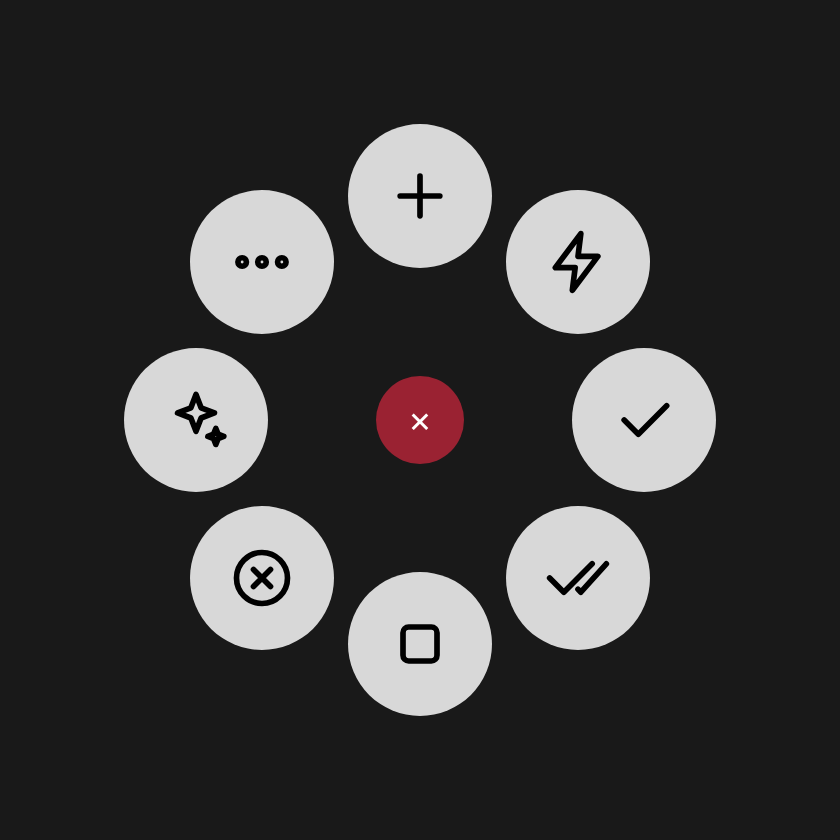

# Claude Code × MX Master 4

**English** · [Español](README.es.md)

Control **Claude Code Desktop** (the *Code* tab of the Claude desktop app) from the **Logitech MX Master 4**:
the **haptic button** (Actions Ring) and the **gesture button**. The same actions are also exposed as an
**MCP server**, so any MCP client can drive the app.



```
                 shared/actions.json  ← single action catalog (Claude Desktop shortcuts)
                 shared/i18n.en.json  ← English strings
                 shared/config.default.json
                        │
   ┌────────────────────┼─────────────────────────┐
   ▼                    ▼                         ▼
logi-plugin/        mcp-server/              profiles/
C# plugin for       MCP server (stdio)       Actions Ring profiles (.lp5, en/es)
Logi Options+       + `claude-mx` CLI        + gesture button guide
(Actions Ring,      (tools: run_action,
 haptic feedback)    switch_model, ...)
```

All three read the same catalog, so a new action is added in one place. Labels show up in English or Spanish
depending on your system language (configurable).

## Actions

| Group | Action | What it does in Claude Desktop |
|---|---|---|
| Sessions | **New session** | `Cmd/Ctrl+N` |
| | Close session | `Cmd/Ctrl+W` |
| | Next / previous session | `Cmd/Ctrl+Shift+]` / `[` |
| Prompt | **Send now** | `Esc` (stops the current response), then `Enter` (sends what you typed) |
| | Send | `Enter` (if Claude is working, the message is delivered when the current action finishes) |
| | **Stop** | `Esc` |
| | Accept suggestion | `Tab` (empty prompt box) |
| Permissions | **Approve all** | Permission menu (`Cmd/Ctrl+Shift+M`) → *Accept edits*: edits are applied without asking one by one |
| | Auto / Plan / Manual mode | Permission menu → matching option |
| | Permission menu | `Cmd/Ctrl+Shift+M` |
| Model | **Switch model** | `Cmd/Ctrl+Shift+I` (opens the menu) |
| | Model: Opus / Sonnet / Haiku | Model menu → option 1 / 2 / 3 (configurable) |
| | Effort | `Cmd/Ctrl+Shift+E` |
| View | Diff pane · Terminal · Browser | `Cmd/Ctrl+Shift+D` · ``Ctrl+` `` · `Cmd/Ctrl+Shift+B` |
| | Side chat · Cycle view · Close pane · Shortcuts | `Cmd/Ctrl+;` · `Ctrl+O` · `Cmd/Ctrl+\` · `Cmd/Ctrl+/` |
| Commands | `/compact` · `/context` · `/code-review` | Types the command and sends it (use with an empty prompt box) |

Shortcuts come from the official docs: <https://code.claude.com/docs/en/desktop> (*Keyboard shortcuts* table).

Every action vibrates the MX Master 4 with its own waveform (send = `completed`, approve = `happy_alert`,
stop = `sharp_collision`, error = `angry_alert`, …).

## Install

### 1. Logi Options+ plugin

You need **Logi Options+** with the MX Master 4 paired.

- **Option A — prebuilt package:** download `ClaudeCode_0.1.0.lplug4` (repo *Actions* tab → latest run → artifact
  `claude-code-mx-master`) and double-click it. Logi Plugin Service installs it.
- **Option B — build it** (needs the [.NET 10 SDK](https://dotnet.microsoft.com/download) and Node 20+):

  macOS:
  ```bash
  ./scripts/build-plugin.sh
  ```
  Windows (PowerShell):
  ```powershell
  ./scripts/build-plugin.ps1
  ```
  If Options+ is installed, the plugin is linked to the service and hot-reloads; the `.lplug4` ends up in `dist/`.

**macOS:** the first time, allow *LogiPluginService* under **System Settings → Privacy & Security →
Accessibility** (the plugin sends keystrokes to Claude through System Events). If an action vibrates with the
error pattern, this is almost always why. Logs: `~/Library/Application Support/Logi/LogiPluginService/Logs/`.

**Windows:** no extra permission needed. Logs: `%LOCALAPPDATA%\Logi\LogiPluginService\Logs\`.

### 2. MX Master 4 profile

Follow **[docs/mx-master-4.md](docs/mx-master-4.md)**. Summary:

**Haptic button → Actions Ring** (*Claude* app profile), clockwise from the top:

| Bubble | Action |
|---|---|
| 1 (top) | New session |
| 2 | Send now |
| 3 | Approve all |
| 4 | 📁 Model → Opus · Sonnet · Haiku · Model menu · Effort |
| 5 | Stop |
| 6 | Plan mode |
| 7 | 📁 View → Diff · Terminal · Browser · Side chat · Cycle view · Close pane · Shortcuts |
| 8 | 📁 More → Send · Accept suggestion · Auto mode · Manual mode · Permission menu · /compact · /context · /code-review |

Icons follow the native Actions Ring style (light gray bubble, black outline). Colors live in `iconColors` in
`shared/ring-layout.json`.

**Gesture button** (plain keystrokes, works even without the plugin):

| Gesture | Action | macOS | Windows |
|---|---|---|---|
| Click | Send | `Return` | `Enter` |
| ↑ up | New session | `⌘N` | `Ctrl+N` |
| ↓ down | Stop | `Esc` | `Esc` |
| ← left | Previous session | `⌘⇧[` | `Ctrl+Shift+[` |
| → right | Next session | `⌘⇧]` | `Ctrl+Shift+]` |

`profiles/ClaudeCode-ActionsRing-en.lp5` (and `-es.lp5` in Spanish) contains the ring above, ready to import in
Options+ (*experimental*, see [limitations](#limitations)). It is generated by `node scripts/generate.mjs` from
`shared/ring-layout.json`.

### 3. Match your Claude Desktop (`~/.claude-mx/config.json`)

"Approve all", "Plan mode" and "Model: X" open a Claude Desktop menu and pick the option by **position** (1-9).
If your menu order differs, copy `shared/config.default.json` to `~/.claude-mx/config.json`
(Windows: `%USERPROFILE%\.claude-mx\config.json`) and adjust:

```json
{
  "language": "auto",
  "permissionMenu": { "manual": 1, "acceptEdits": 2, "plan": 3, "auto": 4 },
  "models": [
    { "label": "Opus",   "menuIndex": 1 },
    { "label": "Sonnet", "menuIndex": 2 },
    { "label": "Haiku",  "menuIndex": 3 }
  ],
  "timing": { "menuOpenMs": 250 },
  "windows": { "keyMapping": "layout" }
}
```

Only include the keys you want to change; everything else falls back to the defaults. The plugin re-reads the file
when it changes, and the "Model: …" bubble names come from `label`.

- `language`: `"auto"` (system language), `"en"` or `"es"`. Action names in Options+ are set when the plugin loads;
  restart Logi Options+ after changing it.
- `timing.menuOpenMs`: raise it (e.g. 400) if the menu doesn't open in time before the option is picked.
- `windows.keyMapping`: `"layout"` uses your keyboard layout to produce `[`, `]`, `` ` ``, `;`… If a shortcut with
  those keys doesn't respond, try `"us"`.

## MCP server

`mcp-server/` exposes Claude Code Desktop as MCP tools.

| Tool | Description |
|---|---|
| `list_actions` | List available actions |
| `run_action` | Run any catalog action (`new-session`, `send-now`, `approve-all`, …) |
| `new_session` | Open a new session and optionally type/send a prompt |
| `set_permission_mode` | `manual` · `acceptEdits` · `plan` · `auto` |
| `switch_model` | By name (`"Opus"`) or by menu position (`"2"`) |
| `type_prompt` | Type text into the prompt box and optionally send it |

Install:

```bash
cd mcp-server && npm install
```

Register it with Claude Code (CLI):

```bash
claude mcp add claude-desktop-control -- node /PATH/claude-code-mx-master/mcp-server/src/index.js
```

Or in any MCP client config (e.g. `claude_desktop_config.json` or `.mcp.json`):

```json
{
  "mcpServers": {
    "claude-desktop-control": {
      "command": "node",
      "args": ["/PATH/claude-code-mx-master/mcp-server/src/index.js"]
    }
  }
}
```

There's also a CLI to try actions without an MCP client:

```bash
node mcp-server/src/cli.js list
```

```bash
node mcp-server/src/cli.js run approve-all
```

```bash
CLAUDE_MX_DRY_RUN=1 node mcp-server/src/cli.js run send-now
```

(`CLAUDE_MX_DRY_RUN=1` prints the AppleScript / keystroke plan without sending anything.)

> Not to be confused with `claude mcp serve`, which exposes Claude Code's *tools* (read/edit files, bash…) as an MCP
> server. This project exposes Claude Code Desktop's *UI* (sessions, permissions, model…).

## Adding or changing actions

1. Edit `shared/actions.json` and its translation in `shared/i18n.en.json` (and `shared/ring-layout.json` if it
   belongs on the Actions Ring).
2. Run `node scripts/generate.mjs` — regenerates the C# classes, icons, haptic events and `.lp5` profiles.
3. `cd mcp-server && npm test`, then rebuild the plugin.

Step types: shortcut (`"mod+shift+i"`, `mod` = Cmd on macOS / Ctrl on Windows), key (`"esc"`, `"enter"`, `"tab"`…),
`{"text": "..."}`, `{"wait": 250}` and config placeholders (`"${permissionMenu.plan}"`).

## Limitations

- **It works through keyboard shortcuts.** Claude Desktop has no external control API, so everything uses the
  documented keys. If a shortcut or menu order changes, adjust `actions.json` or your `config.json`.
- **"Approve all" = *Accept edits* mode.** Claude Desktop doesn't document a shortcut for clicking *Allow* on a
  specific permission prompt; this action switches the mode so it stops asking about edits.
- **"Send now" stops the current response** before sending. To queue a message without interrupting, use "Send".
- **`/compact`, `/context`, `/code-review`** type into the prompt box: use them with an empty box.
- **The `.lp5` profiles are experimental:** they follow the format of a profile exported by Options+ 6.4, but Logitech
  recommends creating profiles in the UI. If Options+ won't import one, build the ring by hand in 2 minutes with the
  table above.
- **Verification:** the plugin builds against the official `PluginApi.dll` (NuGet package `LogiPluginTool` 6.4.2), the
  `.lplug4` passes `logiplugintool verify`, and a parity test confirms the plugin and the MCP server produce exactly the
  same keystroke sequences and labels (en/es) for all 28 actions. It hasn't been tested on a physical MX Master 4 yet;
  if something doesn't respond on your machine, open an issue with the plugin log.

## Layout

```
shared/                 action catalog, English strings, default config and Actions Ring layout
logi-plugin/src/        C# plugin (Logi Actions SDK)
logi-plugin/tests/      C# ↔ Node parity test
logi-plugin/stubs/      minimal PluginApi stub, only for the parity test in CI
mcp-server/             MCP server + CLI (Node)
profiles/               Actions Ring .lp5 profiles (en/es)
scripts/                generator, build and parity
docs/                   MX Master 4 setup guide (en/es)
```

MIT license. Independent project, not affiliated with Anthropic or Logitech.
