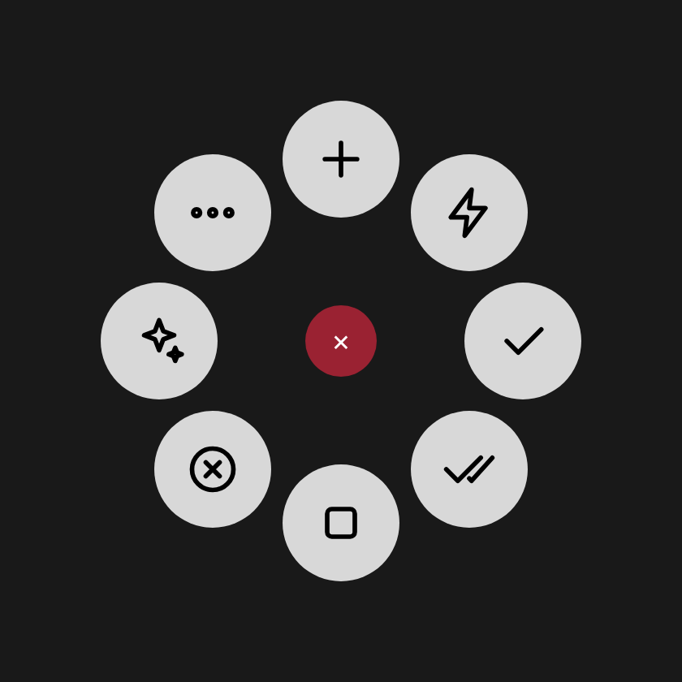

# Configurar el MX Master 4 para Claude Code Desktop

[English](mx-master-4.md) · **Español**

Todo se hace en un **perfil específico de la app Claude**, así los botones solo cambian de función cuando Claude
Desktop está en primer plano y en el resto de apps el mouse sigue igual.

> Los nombres de menús pueden variar un poco según la versión de Logi Options+.

## 0. Antes de empezar

1. Instala **Logi Options+** y empareja el MX Master 4 (Bluetooth o receptor Logi Bolt).
2. Instala el plugin: doble clic en `ClaudeCode_0.1.0.lplug4`. Se abre el instalador de Logi Plugin Service;
   acepta. Si Windows o macOS avisa que el archivo viene de internet, confirma que quieres abrirlo.
3. **Solo macOS:** Ajustes del Sistema → Privacidad y seguridad → **Accesibilidad** → activa *LogiPluginService*
   (y *Logi Options+* si aparece). En Windows no hace falta.
4. **Reinicia Claude Desktop** después de instalar el plugin: al cargarse, el plugin agrega sus hooks a
   `~/.claude/settings.json` (Windows: `C:\Users\TuUsuario\.claude\settings.json`) y Claude Desktop los lee al
   abrir. Así es como el mouse aprueba/rechaza directamente y vibra con los eventos de Claude.
5. Abre Claude Desktop y entra a la pestaña **Code**.

## 1. Crear el perfil de Claude

1. Abre **Logi Options+** y selecciona el **MX Master 4**.
2. Arriba, en el selector de aplicaciones (*Todas las aplicaciones*), pulsa **+ Agregar aplicación** y elige
   **Claude**.
3. Con *Claude* seleccionado, todo lo que configures abajo aplica solo a Claude.

## 2. Botón háptico → Actions Ring

El botón háptico (el panel bajo el pulgar) abre el **Actions Ring**.



En sentido horario desde arriba: Nueva sesión · Enviar ahora · Aprobar · Aprobar todo · Detener · Rechazar · Modelo y modo · Más.

Cuando Claude pide permiso, el mouse vibra (`knock`) y las burbujas de permisos muestran la herramienta, por ejemplo
**Aprobar · Bash**. Tienes 20 s (`bridge.holdSeconds`) para responder desde el mouse; si no, Claude Desktop muestra
su diálogo de siempre.

### Opción A: importar el perfil (experimental)

1. En Options+, entra a la configuración del **Actions Ring** con el perfil *Claude* seleccionado.
2. En el menú del perfil (los **⋯** junto al nombre del perfil) elige **Importar perfil** y selecciona
   `ClaudeCode-ActionsRing-es.lp5` (o `-en.lp5` para inglés).
3. Si no lo acepta o aparece vacío, usa la opción B.

### Opción B: armarlo a mano (2 minutos)

En el Actions Ring del perfil *Claude*, arrastra las acciones del grupo **Claude Code** a cada burbuja:

| Burbuja | Acción (grupo del plugin) |
|---|---|
| 1 (arriba) | Nueva sesión *(Sesiones)* |
| 2 | Enviar ahora *(Prompt)* |
| 3 | Aprobar *(Permisos)* |
| 4 | Aprobar todo *(Permisos)* |
| 5 | Detener *(Prompt)* |
| 6 | Rechazar *(Permisos)* |
| 7 | Carpeta **Modelo y modo**: Modelo: Opus · Modelo: Sonnet · Modelo: Haiku · Cambiar modelo · Esfuerzo · Modo Plan · Modo Auto · Modo Manual · Menú de permisos |
| 8 | Carpeta **Más**: Enviar · Aceptar sugerencia · Panel de diff · Terminal · Navegador · Chat lateral · /compact · /context · /code-review |

Las carpetas se crean con la acción **Carpeta** (navegación) del propio Actions Ring.

Cuando lo tengas como te gusta, puedes **Exportar perfil** y reemplazar `profiles/ClaudeCode-ActionsRing-es.lp5` en
el repo con tu exportación.

### Vibración háptica

En Options+ → MX Master 4 → **Respuesta háptica**, deja activada la vibración. Cada acción del plugin usa una
forma de onda distinta:

| Evento | Forma de onda | Cuándo |
|---|---|---|
| Pide permiso | `knock` | Claude espera tu aprobación |
| Te espera | `ringing` | Claude está inactivo o te hizo una pregunta |
| Terminó | `completed` | Claude terminó su turno |
| Aprobado | `happy_alert` | Aprobar, Aprobar todo, Modo Auto |
| Rechazado | `damp_collision` | Rechazar |
| Detenido | `sharp_collision` | Detener |
| Modelo | `damp_collision` | Cambio de modelo / esfuerzo |
| Mensaje enviado | `wave` | Enviar, Enviar ahora, /compact… |
| Nueva sesión | `damp_state_change` | Nueva sesión |
| Navegación | `subtle_collision` | Sesión siguiente / anterior |
| Nada pendiente | `subtle_collision` | Pulsaste Aprobar/Rechazar sin solicitud pendiente |
| Error | `angry_alert` | La acción falló |

Para cambiarlas, edita `haptics` en `shared/actions.json` y ejecuta `node scripts/generate.mjs`.

## 3. Botón de gestos

Con el perfil *Claude* seleccionado, haz clic en el **botón de gestos** (el del pulgar, delante del panel háptico)
y elige **Gestos** / **Gestos personalizados**. Para cada dirección asigna **Pulsación de tecla** con:

| Gesto | Acción | macOS | Windows |
|---|---|---|---|
| Clic | Enviar | `Return` | `Enter` |
| Mantener + ↑ | Nueva sesión | `⌘ N` | `Ctrl N` |
| Mantener + ↓ | Detener | `Esc` | `Esc` |
| Mantener + ← | Sesión anterior | `⌘ ⇧ [` | `Ctrl Shift [` |
| Mantener + → | Sesión siguiente | `⌘ ⇧ ]` | `Ctrl Shift ]` |

Si tu versión de Options+ permite asignar **acciones de plugin** a los gestos, te recomiendo: clic = *Aprobar*,
↓ = *Rechazar* (o *Detener*). Así respondes a Claude sin abrir el anillo.

## 4. Rueda del pulgar (opcional)

En el perfil *Claude*, la rueda horizontal puede quedarse con su desplazamiento normal (útil en el panel de diff).
Si prefieres, configúrala con pulsaciones de tecla para cambiar de sesión: izquierda `Ctrl Shift Tab`,
derecha `Ctrl Tab`.

## 5. Ajustar al orden de tus menús

Abre en Claude Desktop el menú de permisos (`Ctrl+Shift+M` / `⌘⇧M`) y el de modelos (`Ctrl+Shift+I` / `⌘⇧I`) y
cuenta en qué posición está cada opción. Si no coincide con 1 = Manual, 2 = Accept edits, 3 = Plan, 4 = Auto y
1 = Opus, 2 = Sonnet, 3 = Haiku, crea el archivo de configuración:

- **Windows:** `%USERPROFILE%\.claude-mx\config.json` (por ejemplo `C:\Users\TuUsuario\.claude-mx\config.json`)
- **macOS:** `~/.claude-mx/config.json`

```json
{
  "permissionMenu": { "manual": 1, "acceptEdits": 2, "plan": 3, "auto": 4 },
  "models": [
    { "label": "Opus",   "menuIndex": 1 },
    { "label": "Sonnet", "menuIndex": 2 },
    { "label": "Haiku",  "menuIndex": 3 }
  ]
}
```

## Problemas comunes

| Síntoma | Solución |
|---|---|
| La acción vibra con el patrón de error y no pasa nada (macOS) | Falta el permiso de Accesibilidad para LogiPluginService |
| "Aprobar todo" o "Modelo: X" eligen la opción equivocada | Ajusta `permissionMenu` / `models` en `config.json` según el orden real de tus menús |
| El menú se abre pero no se elige nada | Sube `timing.menuOpenMs` (p. ej. a 400) |
| Atajos con `[`, `]`, `` ` `` no responden (Windows) | Cambia `windows.keyMapping` a `"us"` |
| Las acciones del plugin no aparecen | Reinicia Logi Options+; comprueba que el perfil seleccionado sea *Claude* |
| El mouse no vibra cuando Claude pide permiso | Reinicia Claude Desktop; revisa que `~/.claude/settings.json` tenga entradas con `/claude-mx/hooks/` y que Logi Options+ esté abierto |
| Aprobar/Rechazar vibran "nada pendiente" | No había ninguna solicitud esperando (o ya pasaron los `holdSeconds` y Claude mostró su diálogo) |
| El log dice que no pudo abrir el puerto 47823 | Otro programa lo usa: pon otro en `bridge.port` y reinicia Logi Options+ y Claude Desktop |
| Los nombres salen en el idioma equivocado | Pon `"language": "es"` o `"en"` en `config.json` y reinicia Logi Options+ |
