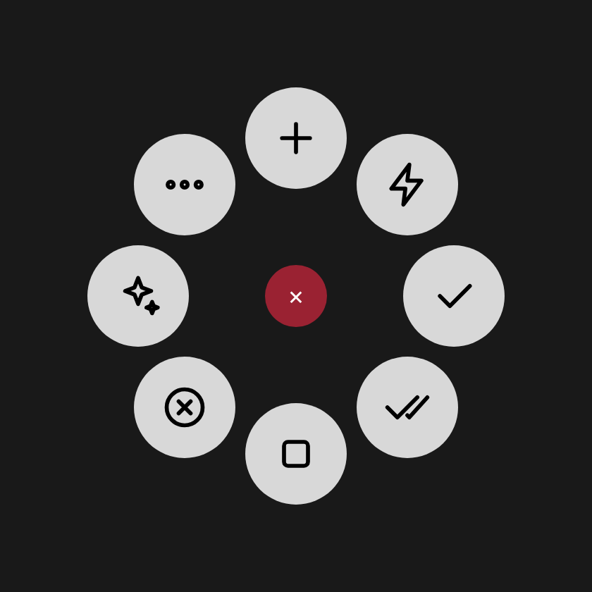

# Set up the MX Master 4 for Claude Code Desktop

**English** · [Español](mx-master-4.es.md)

Everything lives in an **app-specific profile for Claude**, so the buttons only change while Claude Desktop is in
the foreground; everywhere else the mouse behaves as usual.

> Menu names may differ slightly between Logi Options+ versions.

## 0. Before you start

1. Install **Logi Options+** and pair the MX Master 4 (Bluetooth or Logi Bolt receiver).
2. Install the plugin: double-click `ClaudeCode_0.1.0.lplug4`. The Logi Plugin Service installer opens; accept it.
   If Windows or macOS warns that the file came from the internet, confirm you want to open it.
3. **macOS only:** System Settings → Privacy & Security → **Accessibility** → enable *LogiPluginService*
   (and *Logi Options+* if listed). Not needed on Windows.
4. Open Claude Desktop and go to the **Code** tab.

## 1. Create the Claude profile

1. Open **Logi Options+** and select the **MX Master 4**.
2. At the top, in the app selector (*All applications*), click **+ Add application** and pick **Claude**.
3. With *Claude* selected, everything below applies only to Claude.

## 2. Haptic button → Actions Ring

The haptic button (the thumb panel) opens the **Actions Ring**.



Clockwise from the top: New session · Send now · Approve all · Model · Stop · Plan mode · View · More.

### Option A: import the profile (experimental)

1. In Options+, open the **Actions Ring** settings with the *Claude* profile selected.
2. In the profile menu (the **⋯** next to the profile name) choose **Import profile** and select
   `ClaudeCode-ActionsRing-en.lp5` (or `-es.lp5` for Spanish).
3. If it's rejected or shows up empty, use option B.

### Option B: build it by hand (2 minutes)

In the *Claude* profile's Actions Ring, drag actions from the **Claude Code** group onto each bubble:

| Bubble | Action (plugin group) |
|---|---|
| 1 (top) | New session *(Sessions)* |
| 2 | Send now *(Prompt)* |
| 3 | Approve all *(Permissions)* |
| 4 | **Model** folder: Model: Opus · Model: Sonnet · Model: Haiku · Switch model · Effort |
| 5 | Stop *(Prompt)* |
| 6 | Plan mode *(Permissions)* |
| 7 | **View** folder: Diff pane · Terminal · Browser · Side chat · Cycle view · Close pane · Shortcuts |
| 8 | **More** folder: Send · Accept suggestion · Auto mode · Manual mode · Permission menu · /compact · /context · /code-review |

Folders are created with the Actions Ring's own **Folder** (navigation) action.

Once it looks right, you can **Export profile** and replace `profiles/ClaudeCode-ActionsRing-en.lp5` in the repo
with your export.

### Haptic feedback

In Options+ → MX Master 4 → **Haptic feedback**, keep it enabled. Each plugin action uses its own waveform:

| Event | Waveform | When |
|---|---|---|
| Message sent | `completed` | Send, Send now, /compact… |
| Approved | `happy_alert` | Approve all, Auto mode |
| Stopped | `sharp_collision` | Stop |
| Model | `damp_collision` | Switch model / effort |
| New session | `damp_state_change` | New session |
| Navigation | `subtle_collision` | Next / previous session |
| Action | `sharp_state_change` | Everything else |
| Error | `angry_alert` | The action failed (e.g. missing Accessibility permission) |

To change them, edit `haptics` in `shared/actions.json` and run `node scripts/generate.mjs`.

## 3. Gesture button

With the *Claude* profile selected, click the **gesture button** (the thumb button in front of the haptic panel) and
choose **Gestures** / **Custom gestures**. For each direction assign a **Keystroke**:

| Gesture | Action | macOS | Windows |
|---|---|---|---|
| Click | Send | `Return` | `Enter` |
| Hold + ↑ | New session | `⌘ N` | `Ctrl N` |
| Hold + ↓ | Stop | `Esc` | `Esc` |
| Hold + ← | Previous session | `⌘ ⇧ [` | `Ctrl Shift [` |
| Hold + → | Next session | `⌘ ⇧ ]` | `Ctrl Shift ]` |

If your Options+ version lets you assign **plugin actions** to gestures, you can put *Send now* on click and
*Approve all* on a gesture instead of keystrokes.

## 4. Thumb wheel (optional)

In the *Claude* profile, the horizontal wheel can keep its normal scrolling (handy in the diff pane). If you prefer,
set it to keystrokes to switch sessions: left `Ctrl Shift Tab`, right `Ctrl Tab`.

## 5. Match your menu order

In Claude Desktop, open the permission menu (`Ctrl+Shift+M` / `⌘⇧M`) and the model menu (`Ctrl+Shift+I` / `⌘⇧I`)
and count where each option is. If it doesn't match 1 = Manual, 2 = Accept edits, 3 = Plan, 4 = Auto and
1 = Opus, 2 = Sonnet, 3 = Haiku, create the config file:

- **Windows:** `%USERPROFILE%\.claude-mx\config.json` (e.g. `C:\Users\YourName\.claude-mx\config.json`)
- **macOS:** `~/.claude-mx/config.json`

```json
{
  "permissionMenu": { "manual": 1, "acceptEdits": 2, "plan": 3, "auto": 4 },
  "models": [
    { "label": "Opus",   "menuIndex": 1 },
    { "label": "Sonnet", "menuIndex": 2 },
    { "label": "Haiku",  "menuIndex": 3 }
  ]
}
```

## Troubleshooting

| Symptom | Fix |
|---|---|
| The action vibrates with the error pattern and nothing happens (macOS) | Grant Accessibility permission to LogiPluginService |
| "Approve all" or "Model: X" picks the wrong option | Adjust `permissionMenu` / `models` in `config.json` to your actual menu order |
| The menu opens but nothing gets picked | Raise `timing.menuOpenMs` (e.g. to 400) |
| Shortcuts with `[`, `]`, `` ` `` don't respond (Windows) | Set `windows.keyMapping` to `"us"` |
| Plugin actions don't show up | Restart Logi Options+; make sure the *Claude* profile is selected |
| Labels show in the wrong language | Set `"language": "en"` or `"es"` in `config.json` and restart Logi Options+ |
